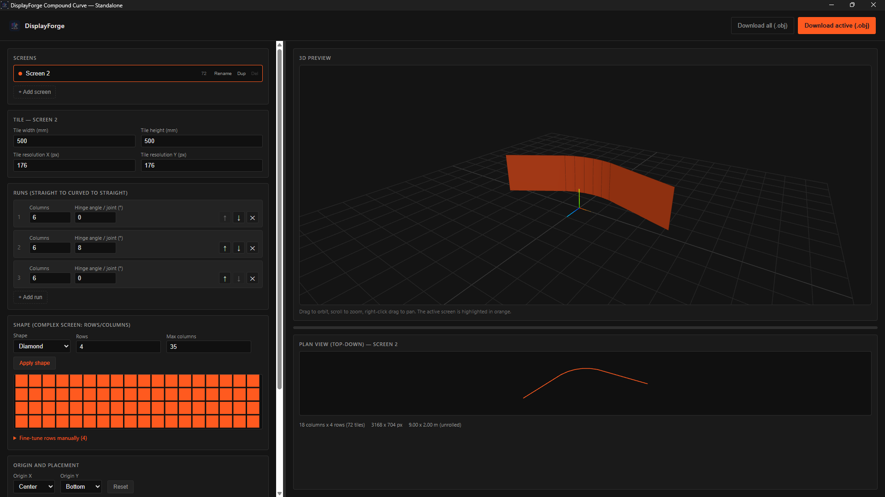
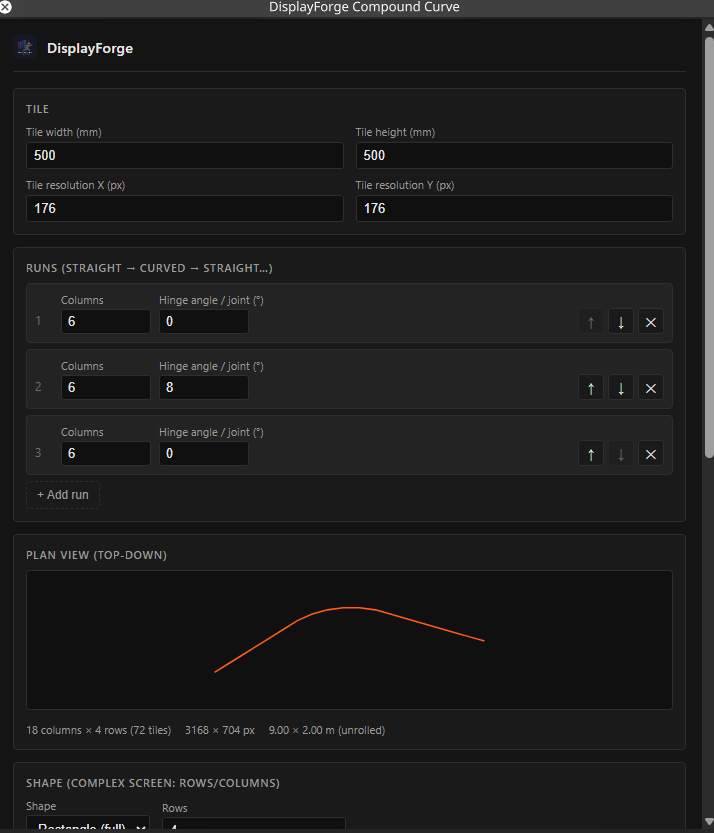
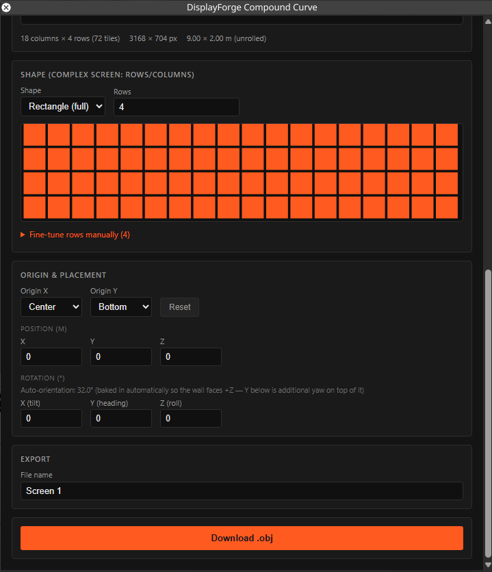

# DisplayForge

Parametric tools for LED display design and media server workflows

**Current web/plugin release: 0.5.0** — [release notes](RELEASE_NOTES.md)

> Design, preview and export compound-curve LED walls and custom-shaped displays for Media Servers and 3d Engines.

DisplayForge is a parametric design tool for creating LED walls ranging from simple flat surfaces to complex compound curves and custom shapes. It exports standard Wavefront OBJ files that can be imported directly into Disguise, Pixera, Blender, Unreal Engine, and other 3D applications.

The application is available in two versions sharing the same geometry engine:

- **Disguise Plugin** – optimized for use inside Designer.
- **Standalone Web Application** – full-featured version with interactive 3D visualization.
- **Standalone Windows Application** – the prebuilt 0.4.0 executable; it is not updated in this release because its source/build project is unavailable.

Download the current [Disguise plugin package](DisplayForge_Plugin.zip) or
[standalone web package](DisplayForge_Standalone.zip) from the repository.
The plugin ZIP contains a `DisplayForge_Plugin` folder ready to extract into
Designer's `Plugins` directory. Its root contains `d3plugin.json`, `index.html`,
`icon.svg`, and the `assets` folder. For the standalone package, extract the
ZIP and serve the extracted folder over HTTP, then open `standalone.html`.

---

# Features

## Compound Curve Engine

Create LED walls composed of multiple consecutive runs:

- Straight sections
- Curved sections
- Straight → Curved → Straight combinations
- Unlimited run sequences

Geometry is generated using the same core algorithms as the main DisplayForge application.

---

## Shape Generator

Generate displays in several predefined layouts:

- Rectangle
- Triangle
- Diamond
- Circle

Every generated shape can be manually edited row by row for complete control over cabinet placement.

Triangle, circle and diamond defaults fit the physical tile and display
dimensions. Circle and diamond profiles account for tile aspect ratio and keep
rows centered with exact left/right symmetry. Changing tile dimensions
recalculates the auto-fit parameters. For example, a 10-by-10 grid of square
tiles produces a circle profile of 4/8/8/10/10/10/10/8/8/4. Manual row edits
remain available, and switching back to Rectangle restores full-width rows.

## Create LED Screen in Disguise

The plugin's **Create LED Screen** action exports the current mesh through the
existing OBJ download workflow, then waits asynchronously for Designer to
load and validate the OBJ before creating the LED screen. It assigns the
generated mesh, applies the pixel resolution configured in DisplayForge, and
adds the screen to the active stage. The plugin uses Designer's
`objects/meshfromobj/<mesh-name>.obj` resource path while the OBJ is stored in
the project's existing `objects/Mesh` folder; it does not create a physical
`objects/meshfromobj` directory.

Designer resource creation and import behavior should be validated against
the target Designer version and project. The release's browser tests use a
mocked Designer API and do not replace that in-Designer validation.

---

## Transform Tools

Precisely position every display using:

- Custom origin point
- World position
- Rotation on X/Y/Z
- Automatic front orientation for curved walls

Unlike renderer-only transformations, all transforms are baked directly into the exported OBJ geometry.

---

## Automatic UV Mapping

Every exported mesh includes a complete, non-overlapping UV map generated automatically during the export process.

This allows the OBJ file to be immediately texture-ready, eliminating the need for manual UV unwrapping in external 3D software and significantly speeding up content creation workflows.

---

## Tile Configuration

DisplayForge is fully parametric and allows every project to be built using any LED cabinet specification.

For each tile you can define:

- Physical width
- Physical height
- Horizontal resolution (pixels)
- Vertical resolution (pixels)

All geometry, dimensions, and exported meshes are automatically generated from these values.

The software continuously calculates and displays the overall display specifications, including:

- Total physical width
- Total physical height
- Total horizontal resolution
- Total vertical resolution
- Total pixel count

This allows designers to instantly verify both the physical size and the effective resolution of the LED wall while editing, regardless of its shape or compound-curve configuration.
---

## Multiple Screens (Standalone)

The standalone version supports complete multi-screen projects.

Each screen has its own:

- Tile specifications
- Compound curve
- Shape
- Position
- Rotation

Functions include:

- Add
- Duplicate
- Rename
- Delete

All screens can be exported individually or merged into a single OBJ file.

---

## Interactive 3D Preview

Available only in the standalone version.

Features include:

- Orbit controls
- Real-time geometry updates
- Multi-screen visualization
- Automatic framing
- Simultaneous 2D plan view

The Disguise plugin intentionally excludes the 3D viewer because Designer's embedded browser currently does not expose a usable WebGL context.

---

# OBJ Export

DisplayForge exports production-ready Wavefront OBJ files with all geometric data already prepared for use in real-time rendering and content creation workflows.

Each exported mesh includes:

- Optimized geometry
- Vertex normals
- Fully generated UV mapping
- Origin baked into the mesh
- Position baked into the mesh
- Rotation baked into the mesh

The generated UV layout is automatically created during mesh generation, allowing textures, media, or calibration assets to be applied immediately without requiring manual UV unwrapping in external 3D software.

The exported OBJ files can be imported directly into applications such as Disguise Designer, Pixera, Blender, Unreal Engine, Unity, and other software supporting the Wavefront OBJ format.

# Plugin vs Standalone

| Feature | Plugin | Standalone |
|----------|---------|------------|
| Runs inside Disguise Designer | ✔ | ✖ |
| 3D Preview | ✖ | ✔ |
| Multiple Screens | ✖ | ✔ |
| OBJ Export | ✔ | ✔ |
| Shape Generator | ✔ | ✔ |
| Compound Curves | ✔ | ✔ |
| Origin & Transform Tools | ✔ | ✔ |

---

## Release contents

- `DisplayForge_Plugin.zip` — Disguise plugin build in a `DisplayForge_Plugin` folder, including the standalone web entry point.
- `DisplayForge_Standalone.zip` — standalone web application.
- `DisplayForge 0.4.0.exe` — existing executable, unchanged.
