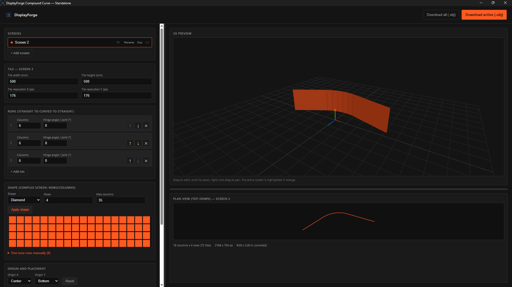
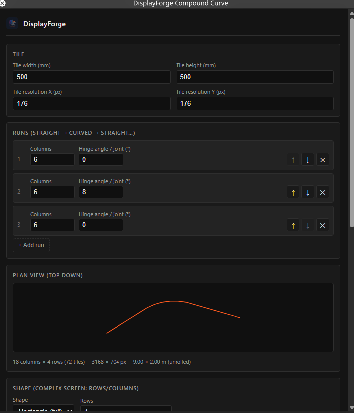
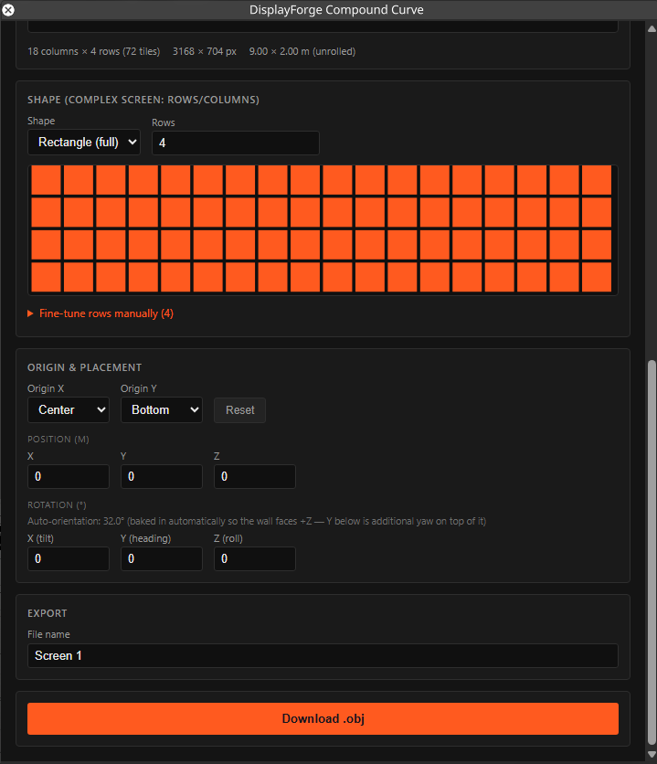

# DisplayForge

Parametric tools for LED display design and media server workflows

**Current web/plugin release: 0.6.0** — [release notes](RELEASE_NOTES.md)

> Design, preview and export compound-curve LED walls and custom-shaped displays for Media Servers and 3D engines.

DisplayForge is a parametric design tool for creating LED walls ranging from simple flat surfaces to complex compound curves and custom shapes. It exports standard Wavefront OBJ files that can be imported directly into Disguise, Pixera, Blender, Unreal Engine, and other 3D applications.





The application is available in several versions built from the same source code (`src/`):

- **Disguise Plugin** – runs inside Designer and can create the LED screen directly.
- **Standalone Web Application** – full-featured version with interactive 3D visualization.
- **Standalone Windows Application** – portable Windows x64 executable, available on the [Releases page](https://github.com/stefanpetrAV/DisplayForge/releases) (`DisplayForge 0.6.0.exe`). Saved screens are kept between sessions.

Download the [Disguise plugin package](DisplayForge_Plugin.zip) or the
[standalone web package](DisplayForge_Standalone.zip).
The plugin ZIP contains a `DisplayForge_Plugin` folder ready to extract into
Designer's `Plugins` directory; its root contains `d3plugin.json`, `index.html`,
`icon.svg`, `python/` and `assets/`. For the standalone package, extract the
ZIP, serve the extracted folder over HTTP and open `standalone.html`.

---

# Features

## Compound Curve Engine

Create LED walls composed of multiple consecutive runs (straight, curved, straight → curved → straight, unlimited sequences).

Each run has a column count and a **hinge angle**. The angle is applied at the
joint *before* every column of the run, including the joint with the previous
run, so a one-column run works as a single hinge between two sections.
Positive angles bend the wall towards the audience.

## Shape Generator

Rectangle, Triangle, Circle and Diamond layouts, plus **Custom** rows edited by hand.

- **Rows are numbered top-to-bottom: Row 1 is the top row.** The 2D grid, the
  row table, the 3D preview and the exported OBJ all use this convention.
- Triangle, circle and diamond sizes can auto-fit the physical tile and grid
  dimensions (untick *Auto-fit size* to keep a manual value). Circle and
  diamond profiles account for tile aspect ratio and keep exact left/right
  symmetry; e.g. a 10×10 grid of square tiles gives the circle profile
  4/8/8/10/10/10/10/8/8/4.
- Editing a row by hand switches the shape to *Custom*, so later grid changes
  never overwrite manual rows.

## Multiple Screens and memory

Both the plugin and the standalone app manage a list of screens (add,
duplicate, rename, delete). Each screen keeps its own tile spec, runs, shape,
placement and the record of the LED screen created in Designer.

Screens are saved automatically:

- **Plugin** – in the Designer project, file `displayforge/screens.json`
  inside the project folder (plus a local browser copy). Reopening the plugin
  in the same project restores all screens.
- **Standalone** – in the browser's local storage.

## Create LED Screen in Disguise

**Create LED Screen in Designer** (plugin only) exports the active screen's OBJ
through the normal download workflow, waits asynchronously for Designer to
load and validate the mesh from the project's `objects/Mesh/<name>.obj`, then creates or
updates `objects/ledscreen/<name>.apx`, assigns the mesh, sets the pixel
resolution shown in DisplayForge and adds the screen to the stage. The file /
resource name is derived from the screen name (lowercase, `a-z 0-9 _ -`).

## Transform Tools

Origin (left end / center / right end of the wall × bottom / middle / top),
world position and X/Y/Z rotation. An automatic orientation turns the middle
of a curved wall towards +Z first. All transforms are baked into the OBJ.

## Coordinate conventions

| | |
|---|---|
| Units | metres |
| Axes | right-handed, +Y up (OBJ / three.js) |
| Front of the wall | faces +Z (the audience); back faces are drawn dark grey in the 3D preview |
| Columns | left → right as seen from the front |
| Rows | top → bottom (Row 1 = top) |
| UV | u = 0 left → 1 right, v = 0 bottom → 1 top, over the full unrolled grid |
| Plan view | top-down, +X right, front/audience (+Z) at the bottom |

The plan view and the 3D preview are generated from the same world-space
points as the exported mesh, so they always agree.

## Interactive 3D Preview

Orbit controls, real-time updates, multi-screen visualization, automatic
framing. In the plugin it is an optional, collapsible panel (Designer's
embedded browser may not provide WebGL; a fallback message is shown).

# Plugin vs Standalone

| Feature | Plugin | Standalone |
|----------|---------|------------|
| Runs inside Disguise Designer | ✔ | ✖ |
| Create LED screen in Designer | ✔ | ✖ |
| Multiple screens | ✔ | ✔ |
| Screens remembered | ✔ (in the Designer project) | ✔ (browser) |
| 3D preview | optional | ✔ |
| OBJ export (single / all merged) | ✔ | ✔ |
| Shape generator, compound curves, transforms | ✔ | ✔ |

---

# Development

```
npm install
npm run dev        # http://localhost:5173/ (plugin page) and /standalone.html
npm test           # geometry / convention unit tests (vitest)
npm run build      # type-check + build into dist/
npm run package    # build + DisplayForge_Plugin.zip / DisplayForge_Standalone.zip
npm run desktop    # run the standalone app in Electron
npm run package:exe  # portable Windows exe -> release/desktop/DisplayForge <version>.exe
```

| Path | Content |
|---|---|
| `src/core/` | geometry engine (tile chain, mesh, shapes, placement, OBJ) — framework-free, unit-tested |
| `src/state/` | screen store + persistence, Designer Python bridge |
| `src/components/` | Vue components (editors, plan view, 3D viewer) |
| `src/App.vue` | UI shared by plugin (`index.html`) and standalone (`standalone.html`) |
| `public/python/displayforge.py` | Python module registered in Designer (LED screen creation, project storage) |
| `public/d3plugin.json` | Designer plugin manifest |
| `desktop/main.cjs` | Electron wrapper for the portable Windows build |

## Release contents

- `DisplayForge_Plugin.zip` — Disguise plugin (`DisplayForge_Plugin` folder; also contains the standalone page).
- `DisplayForge_Standalone.zip` — standalone web application.
- `DisplayForge 0.6.0.exe` — portable Windows x64 standalone app, attached to the GitHub release (not committed: large binaries belong in Releases).
- `DisplayForge 0.5.0.exe`, `DisplayForge 0.4.0.exe` — previous builds kept in the repository; they predate the 0.6.0 fixes.
